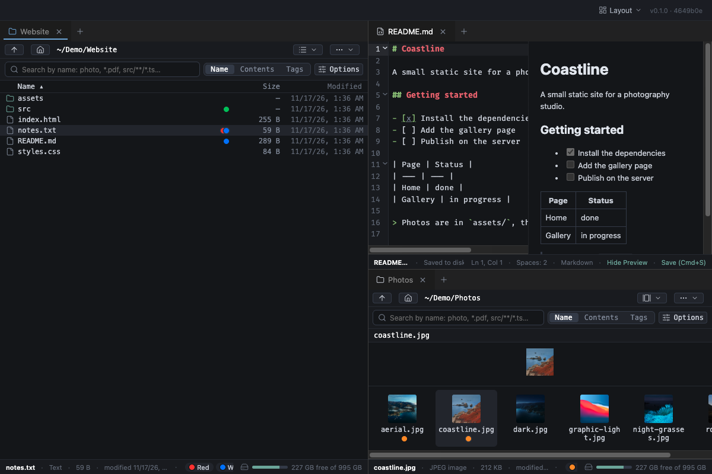
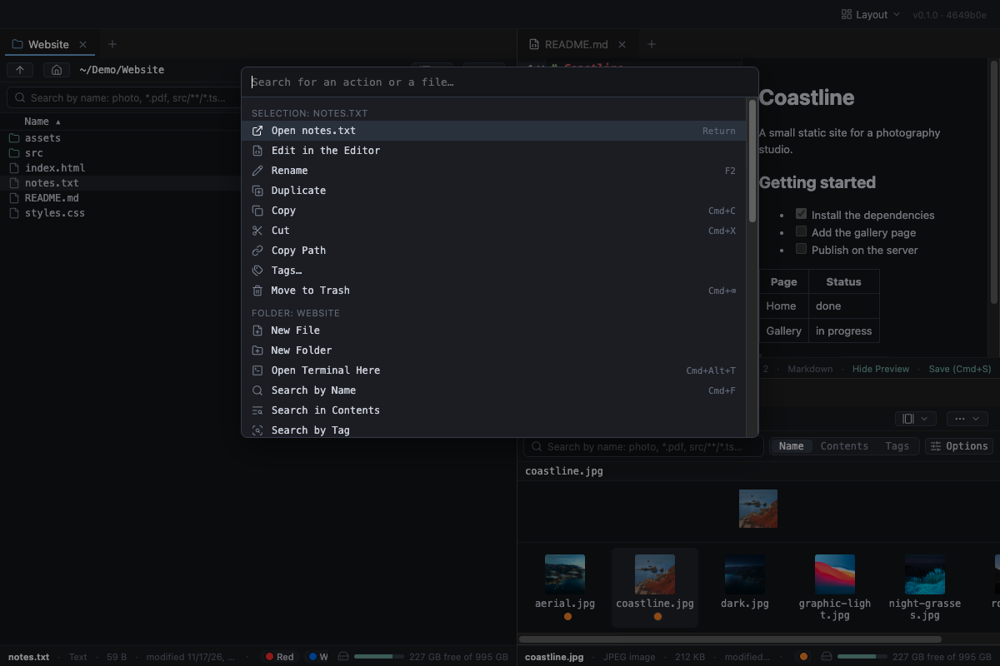
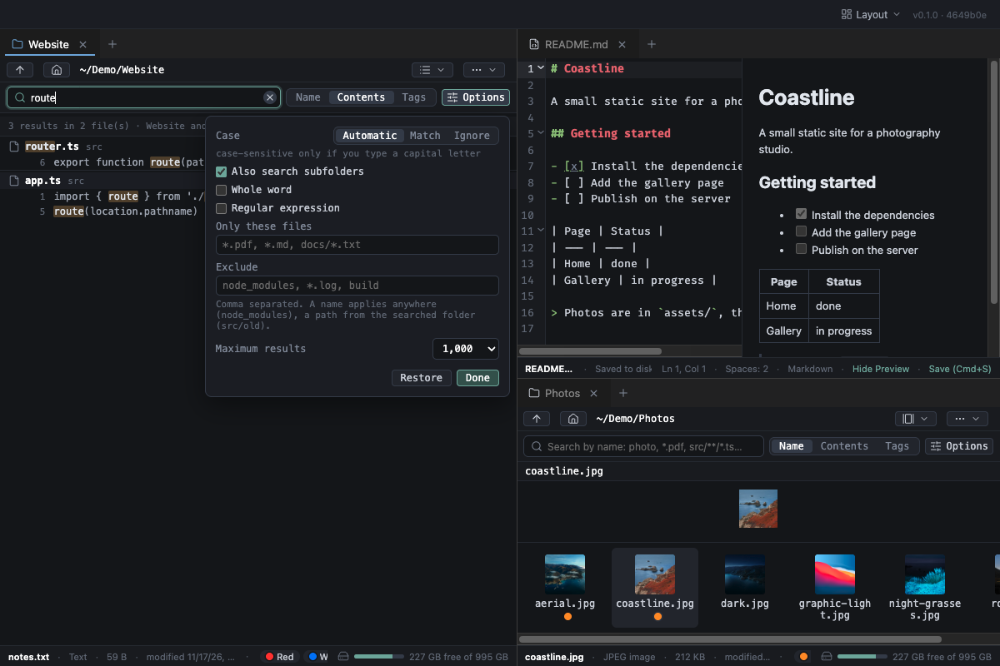

<p align="center">
  
</p>

<h1 align="center">Cassetto</h1>

<p align="center">
  <b>A file manager for macOS and Linux, for days spent working with files.</b><br>
  Tabs and side-by-side panels, empty files in one click, a Raycast-style action bar,<br>
  fast search, a code editor and a terminal, all in one window.
</p>

<p align="center">
  <a href="https://mkis78.github.io/cassetto/"><b>mkis78.github.io/cassetto</b></a>
</p>

<p align="center">
  
  
  
  
  <a href="LICENSE"></a>
  <a href="https://claude.com/claude-code"></a>
</p>

<p align="center">
  <a href="#why-cassetto">Why</a> ·
  <a href="#features">Features</a> ·
  <a href="#install">Install</a> ·
  <a href="#keyboard">Keyboard</a> ·
  <a href="#development">Development</a>
</p>



> [!WARNING]
> Cassetto is still under active development and may contain bugs. It moves, copies and deletes files, so keep backups of anything important.
> The software is provided "as is", without warranty of any kind, and the author is not liable for any damage or data loss arising from its use. See the [LICENSE](LICENSE) for the full terms.

## Why Cassetto

The file manager that comes with your system is great for browsing. Cassetto is meant for the days when you work with files for hours: moving them between folders, creating new ones, searching inside them, changing a line in a config file, running a command where they live. It brings those steps together in one window, so you don't have to switch between apps.

You open folders in tabs, split them into panels and drag between them, and you create files and folders where you are. From the same place you search names, contents or tags, edit text and code, and open a terminal in any folder, on your computer or on a server over SSH. Everything is a few keys away, through an action bar in the style of Raycast.

Cassetto works alongside the Finder or your Linux file manager rather than replacing them: same files, same Trash and, on macOS, the same tags.

### The name

*Cassetto* (pronounced *kahs-SET-toh*) is Italian for **drawer**: the place where you put things away so you can find them again, each where it belongs. That is what the app is for: your files tidy and at hand, without hunting through windows to get to them.

## Features

### Tabs and panels

- **Tabs**: Cmd+T or the **+** after the tabs opens a new one. Double-click a tab to rename it; right-click to give it a colour.
- **Panels**: drag a tab onto the edge of another to split the window, or pick a ready-made arrangement from **Layout** in the top bar: one panel, two side by side or stacked, three columns, one large and two on the right, a 2×2 grid. Your tabs fill the cells in order.
- **Saved layouts**: save the open tabs (folders, views, panel sizes) under a name and bring them back later from the same **Layout** menu.
- Everything you leave open comes back when you reopen the app.

### Files and folders

- **Four views**: list (sortable by name, size, date), icons, columns and gallery, with thumbnails.
- **Create** an empty file or a folder right where you are, from the **⋯** menu, the right-click menu or the action bar.
- **Move and copy by dragging**, within a panel or from one panel to another (hold Option to copy). Cut, copy and paste with Cmd+X/C/V; duplicate; rename with F2. Name clashes ask what to do: replace, skip or keep both.
- **Trash** for local files, with a clear warning when something can only be deleted for good.
- **Preview** text, Markdown, images, PDFs, video and audio with the space bar. PDFs, video and audio preview on your own computer only, not on SSH servers.
- **Status bar** at the foot of each panel: what the folder holds and how much it weighs, the selected file's kind, size and date, the total of a folder on request, and the free space on the disk.

### Archives

Double-click a `.zip`, `.tar`, `.tar.gz` (and the other tar formats), `.7z` or `.rar` to **open it as a folder**, locally or on an SSH server: browse, preview, search and open what's inside without leaving Cassetto. It is read-only: take files out by dragging them to another panel or the sidebar, or with copy and paste (always a copy; the archive is never changed). Leave it like any folder (up from its top, Home, the sidebar). To unpack it all instead, right-click → **Extract Here**. On Linux, `.7z` and `.rar` need `bsdtar` (libarchive-tools), `7z` (p7zip) or `unrar` installed; macOS reads them out of the box.

### Sidebar

A sidebar with the places you go to most. **Cmd+Alt+S** (Ctrl+Alt+S on Linux) switches it between the full panel and a slim icon rail.

- **Favourites**, **Places**, **Disks** (with an eject button and a meter of the space used) and **Servers**: the last five you opened, and **All servers…** for every host of your SSH config (the rail shows a single server icon for the list).
- **Click** an item to open it in the active panel, **Cmd+click** to open it in a new tab, or drag it onto a panel to open it there.
- **Drop files on an item** to move them there (hold Option to copy); between machines, or out of an archive, a drop copies.
- **Favourites**: add a folder with right-click → **Add to Favourites**, from the action bar, or by dragging it into the sidebar. Drag to reorder; right-click to rename, colour or remove. In Settings, show them as a **List** or as **Tiles**.

### Transfers

Copies and moves run in the background, one after another, with their progress in the top bar: a ring with how far along they are, and a click lists each one with its size, speed and time left, and **Cancel** (nothing half-copied is left behind). Files also go **between your Mac and your SSH servers**, or from one server to another, with the same gestures: drag them from one panel to another, or copy and paste. Between machines a drop always copies; Cut and Paste moves. What failed is listed under the transfer until you **Clear** it. Transfers between machines can't be undone.

### Undo

**Cmd+Z** (Ctrl+Z on Linux) in a files panel undoes the last move, copy, rename, new file or folder, or move to the Trash, which brings the item back from the Trash. It is also in the action bar. Permanent deletes can't be undone. On an SSH server, a created item is removed only if you haven't changed it since.

### Open With

Right-click a local file → **Open With** lists the apps that can open it, the default first, plus **Other app…** to pick any other. It is in the action bar too. On macOS the apps show their icons.

### Action bar



**Ctrl+Space** opens a bar of everything you can do right now: actions on the selection, on the folder, the editor's commands, arrangements, saved layouts. Type a few letters to find one, or a file name to open it. If macOS already uses Ctrl+Space (for switching input source), Cassetto tells you and lets you record another shortcut in Settings.

### Search



- Search the open folder by **name** (`invoice`, `*.pdf`, `src/**/*.ts`), by **content**, or by **tag**.
- Results stream in as they are found, with what you typed highlighted.
- **Options**: case (automatic, match, ignore), subfolders on or off, whole word, regular expression, only some files (`*.md, docs/*.txt`), exclusions (`node_modules, *.log`) and how many results at most. Excluded folders are not even read.
- Inside a Git repository, ignored files are skipped.

### Finder tags (macOS)

Colour and name your files with the **Finder's own tags**: they are stored in the file the way the Finder stores them, so they show in the Finder and in Spotlight, and they follow the file wherever it goes. Right-click → **Tags** offers the seven colours and your own tags; **Edit Tags…** adds new ones by name and colour. Search by tag name or by colour ("red").

### Editor

Open any text file in a tab: an editor built on [CodeMirror 6](https://codemirror.net/), light and quick, with syntax highlighting for dozens of languages, find and replace, and Sublime Text's keys: Cmd+D next occurrence, Cmd+Ctrl+G all occurrences, Cmd+Shift+L one cursor per line, Cmd+Ctrl+↑↓ move lines, Cmd+Shift+D duplicate, Cmd+J join, F5 sort, Cmd+R go to a function or heading. Markdown files get a live preview beside the text and formatting keys (Cmd+B, Cmd+I, Cmd+E…). A dot on the tab marks unsaved changes; Cassetto asks before losing them and before overwriting a file changed on disk.

### Terminal

**Open Terminal Here** (Cmd+Alt+T) opens your own shell in a tab, in the folder you are looking at. In a panel on an SSH server, the terminal opens on that server, in the same folder.

### SSH servers

Cmd+K lists the hosts of your `~/.ssh/config`. A server's folders open in a tab like local ones: browse, preview, search, edit, copy, move and delete, with the same keys.

### And also

- **macOS and Linux**: the same app on both, with Linux-style shortcuts on Linux (see [Keyboard](#keyboard)).
- **English and Italian**, following your system's language or chosen in Settings.
- **Dark, light or system theme**, in Settings (Cmd+,).
- **Updates**: the installed app checks GitHub for new releases, shows **↑ vX.Y.Z** in the top bar, and on a click downloads the new version, checks its SHA-256 against the one GitHub publishes, replaces itself and restarts.

## Install

### macOS

Download the latest `.dmg` from [Releases](https://github.com/mkis78/cassetto/releases/latest) for your Mac (`arm64` for Apple Silicon, `x64` for Intel) and drag **Cassetto** into **Applications**. It needs macOS 13 Ventura or later.

The app is not yet signed with an Apple Developer ID, so the first time macOS refuses to open it. To allow it:

1. Open Cassetto once and dismiss the warning with **Done**.
2. Go to **System Settings → Privacy & Security**, scroll down to *"Cassetto" was blocked…* and click **Open Anyway**, then confirm with your password or Touch ID.

Or, from the Terminal, remove the quarantine flag macOS puts on downloaded apps:

```sh
xattr -dr com.apple.quarantine /Applications/Cassetto.app
```

After that it opens normally, and it updates itself.

### Linux

Download the latest `.AppImage` (x64) from [Releases](https://github.com/mkis78/cassetto/releases/latest), make it executable and run it:

```sh
chmod +x Cassetto-*.AppImage
./Cassetto-*.AppImage
```

It updates itself like on macOS. Finder tags are a macOS feature, so they are not available on Linux; everything else works the same.

## Keyboard

The keys below are for macOS. On Linux, Ctrl takes the place of Cmd; the window-wide ones (new and close tab, next and previous tab, go to a file, SSH server) and the terminal's copy and paste take Ctrl+Shift, so plain Ctrl stays free for the editor and the shell. The app's menus show the exact keys.


| Where | Keys |
|---|---|
| Anywhere | Ctrl+Space action bar · Cmd+P go to a file · Cmd+Shift+P commands · Cmd+T new tab · Cmd+W close tab · Cmd+] / Cmd+[ next / previous tab · Cmd+Alt+T terminal here · Cmd+K SSH server · Cmd+, settings · Cmd+Alt+S sidebar: full / icons |
| Files | ↑↓ (←→ in icons, gallery and columns) select · Return or Cmd+↓ open · Backspace or Cmd+↑ enclosing folder · Space preview · F2 rename · Cmd+C/X/V copy, cut, paste · Cmd+Backspace move to Trash · Cmd+Z undo · Cmd+A select all · Cmd+F search · a letter jumps to the next name |
| Editor | Cmd+S save · Cmd+F find · Cmd+D next occurrence · Cmd+Ctrl+G all occurrences · Cmd+Shift+L split into lines · Cmd+Ctrl+↑↓ move line · Cmd+Shift+D duplicate line · Cmd+Shift+K delete line · Cmd+J join lines · F5 sort lines · Cmd+/ comment · Cmd+K Cmd+U/L upper / lower case · Ctrl+G go to line · Cmd+R go to symbol · Alt+Z word wrap |
| Markdown | Cmd+Shift+V preview · Cmd+B bold · Cmd+I italic · Cmd+E code · Cmd+Alt+K link · Cmd+Alt+1/2/3 headings |
| Terminal | Cmd+F search the output · Cmd+C/V copy, paste |

## Privacy and security

Cassetto runs on your computer and talks to nothing but the servers you open over SSH and, to check for updates, GitHub. The interface is served from its own `app://` scheme and cannot read files on its own; it runs sandboxed, with no browser permissions (camera, microphone, location…). The packaged app turns off Electron's `RunAsNode`, `NODE_OPTIONS` and `--inspect`, and checks the integrity of its own code at start, so no other program can borrow it, or the permissions you give it, to run code of its own.

## Development

Node.js LTS.

```sh
npm install      # also rebuilds node-pty for Electron
npm run dev      # hot reload; main and preload rebuild and the app restarts
npm test         # vitest
npm run dist     # dist/Cassetto-<version>-arm64.dmg and -x64.dmg, dist/mac-arm64/Cassetto.app
```

### Releasing

From a clean `main`:

```sh
npm run release:patch   # 0.1.0 → 0.1.1, fixes
npm run release:minor   # 0.1.0 → 0.2.0, features
npm run release:major   # 0.1.0 → 1.0.0
```

The command runs the tests, bumps the version in `package.json`, commits, tags `vX.Y.Z` and pushes. `.github/workflows/release.yml` then builds the macOS `.dmg` and `.zip` (Apple Silicon and Intel) and the Linux `.AppImage` and attaches them to the release, where installed apps find them.

### Languages

Every visible text goes through `t('…')` from `src/shared/i18n.ts`, with the Italian as the key and variables in braces: `t('{n} elementi', { n })`. Translations live in `src/shared/locales/`. Adding a language takes one more dictionary; `test/i18n.test.ts` fails if any text is left without its translation.

### Project layout

```
src/main/      Electron main process: listing, preview, file operations, search, Finder tags, ssh,
               terminals (node-pty), updates, the app:// scheme, menus, state
src/preload/   IPC bridge between main and the interface
src/renderer/  React interface: tabs and panels (dockview), files, search, editor (CodeMirror),
               terminal (xterm.js), action bar, dialogs
src/shared/    Pure logic shared by both: types, menus, search options, tags format, status texts,
               arrangements, languages
test/          Vitest
docs/          Website (GitHub Pages) and screenshots
```

## Support Cassetto

Cassetto is built at night, fuelled entirely by coffee. Every cup you buy is another sleepless night spent on the next feature. My sleep schedule is already ruined: you might as well make it worth it.

[](https://ko-fi.com/V2J029S4NZ)

## Credits

Designed by Marco Pennisi. Built on [Electron](https://www.electronjs.org/), [React](https://react.dev/), [dockview](https://dockview.dev/), [CodeMirror](https://codemirror.net/), [xterm.js](https://xtermjs.org/) and [node-pty](https://github.com/microsoft/node-pty), [marked](https://marked.js.org/) and [Lucide](https://lucide.dev/) icons.

## License

Released under the [MIT License](LICENSE).
