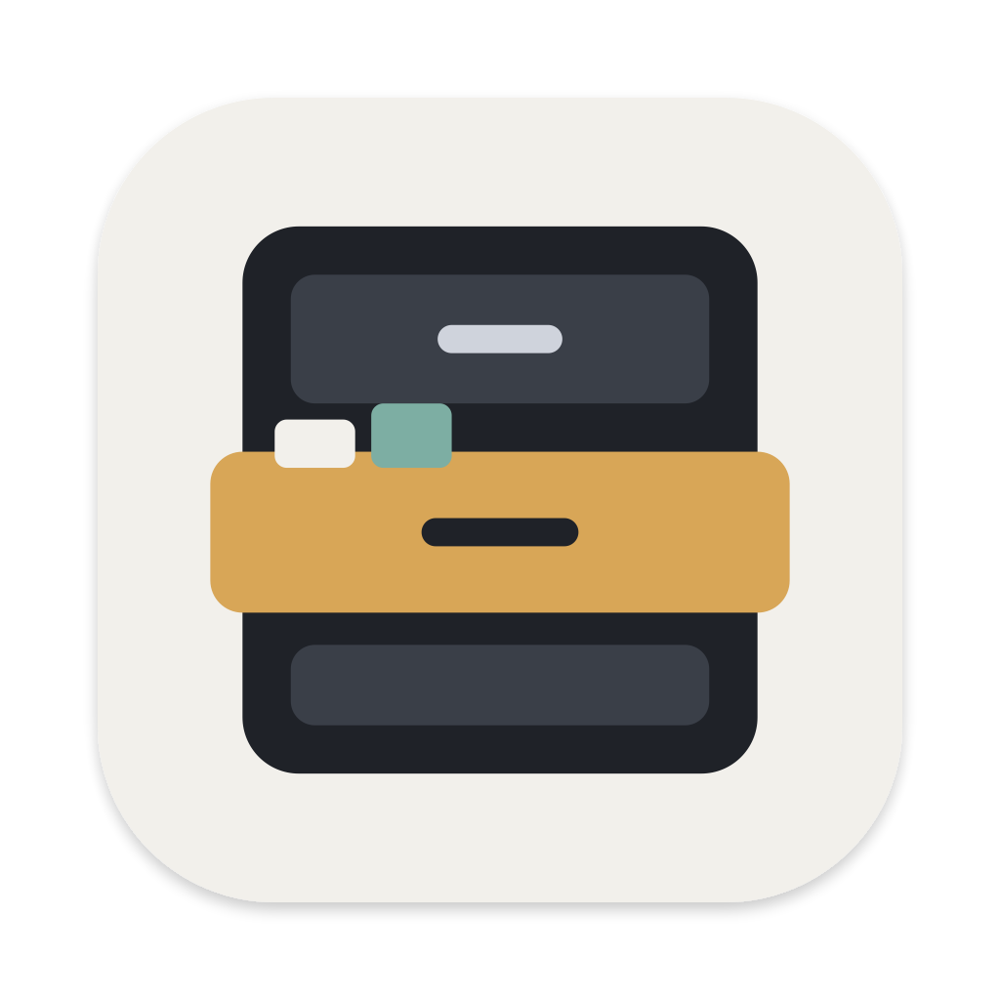

<p align="center">
  
</p>

<h1 align="center">Cassetto</h1>

<p align="center"><b>Un file manager per macOS, alternativo a Finder.</b></p>

## Cosa fa già

- **Tab e pannelli**: Cmd+T nuovo tab, trascina un tab sul bordo di un altro per affiancarli (doppio pannello), Cmd+] / Cmd+[ per passare dall'uno all'altro. Layout e cartelle tornano al riavvio.
- **Quattro viste**: elenco (ordinabile per nome, dimensione, data), icone, colonne, galleria con miniature.
- **Nuovo file vuoto** e nuova cartella, dalla barra o dal menu contestuale.
- Rinomina (F2), duplica, copia/taglia/incolla (Cmd+C/X/V), trascina per spostare (Alt per copiare), Cestino, conflitti di nome gestiti.
- **Anteprima** (spazio) di testo, markdown e immagini.
- **Tag** del Finder: pallini colorati accanto ai nomi, sottomenu Tag (i sette colori e i tag personalizzati), Modifica tag… per nome e colore; condivisi con il Finder e Spotlight.
- **Ricerca** per nome (`*.ts`, `src/**/*.tsx`), contenuto o tag (anche per colore) sotto la cartella aperta.
- **Vai a file** (Cmd+P) e **comandi** (Cmd+Shift+P).
- **Server SSH** (Cmd+K): sfoglia, copia, sposta ed elimina file remoti con gli host di `~/.ssh/config`.
- **Editor** (CodeMirror 6): «Modifica nell'editor» dal menu di un file; evidenziazione per decine di linguaggi, Cmd+F, Cmd+S, più cursori. I file remoti si aprono qui.
- **Terminale** (Cmd+Alt+T, o «Apri terminale qui» dal menu): una shell in un tab, nella cartella scelta; su un server SSH si apre lì.

## Lingue

Italiano e inglese: la lingua segue quella del Mac e si cambia in Impostazioni (si applica al riavvio). Nel codice ogni testo visibile passa da `t('…')` di `src/shared/i18n.ts`, con l'italiano come chiave e le variabili tra graffe (`t('{n} elementi', { n })`); le traduzioni stanno in `src/shared/locales/`. Per aggiungere una lingua basta un nuovo dizionario; `test/i18n.test.ts` fallisce se un testo resta senza traduzione.

## Sviluppo

Node.js LTS.

```sh
npm install
npm run dev      # hot reload; main e preload si ricompilano e l'app si riavvia
npm test         # vitest
npm run dist     # dist/Cassetto-<version>-arm64.dmg
```

### Aggiornamenti e rilasci

L'app installata controlla all'avvio, ogni 6 ore e da *Cassetto → Controlla aggiornamenti…* l'ultima release di GitHub. Se è più recente compare **↑ vX.Y.Z** nella barra in alto: un clic scarica lo zip, ne verifica lo SHA-256 con quello pubblicato da GitHub, sostituisce l'app e la riavvia. Serve che il repository sia pubblico.

Per pubblicare una versione, dal ramo `main` pulito:

```sh
npm run release:patch   # 0.1.0 → 0.1.1 (correzioni)
npm run release:minor   # 0.1.0 → 0.2.0 (novità)
npm run release:major   # 0.1.0 → 1.0.0
```

Il comando esegue i test, alza la versione in `package.json`, crea il commit e il tag `vX.Y.Z` e li invia: `.github/workflows/release.yml` compila `.dmg` e `.zip` per macOS e `.AppImage` per Linux e li allega alla release.

```
src/main/      processo principale: elenco, anteprima, operazioni sui file, ricerca, ssh, stato
src/preload/   ponte IPC
src/renderer/  React: tab dockview, FilesTile, ricerca, palette, dialoghi
src/shared/    logica pura: tipi, menu, ordinamento, navigazione liste, formati
test/          Vitest
```

## Credits

Ideato da Marco Pennisi e costruito con [Claude](https://claude.com/claude-code). Basato su [Electron](https://www.electronjs.org/), [React](https://react.dev/), [dockview](https://dockview.dev/), [Lucide](https://lucide.dev/).
